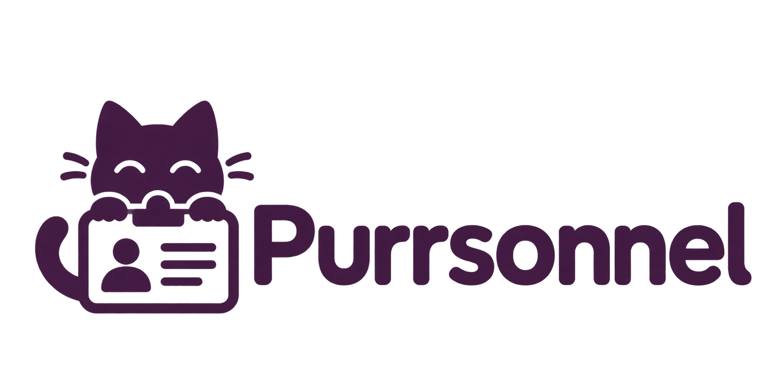

<p align="center"></p>

# Purrsonnel

A personnel workspace for Furry Weekend Atlanta: people, departments, volunteer time, applications, agreements, and requests for help in one place.

**v0.1.0 · initial development release.** This repository is prepared for running on a Docker-capable development machine. It uses fictional accounts and data. Public deployment remains blocked until the real myFWA authentication provider is implemented. Frontend lint, formatting, TypeScript, 78 tests, and the static build pass locally; backend/Docker and real-device checks remain pending. See [release notes](CHANGELOG.md) and [build progress](docs/BUILD_PROGRESS.md) for the exact limits.

## Start with Docker

You need Git (or a copy of this folder), Docker Engine/Desktop with the Compose plugin, and an internet connection for the first image build. You do **not** need Node, Rust, PostgreSQL, or nginx installed on the host.

Clone the repository and enter its root directory:

```sh
git clone https://github.com/dryeena/purrsonnel.git
cd purrsonnel
docker --version
docker compose version
```

For a private repository, authenticate Git with an account that has access. Run Docker Desktop/Engine before starting Compose. On Windows, use Docker's Linux-container mode.

From the repository root, create your local configuration:

```powershell
# PowerShell
Copy-Item .env.example .env
```

```sh
# macOS / Linux
cp .env.example .env
```

Build and start the release-style stack:

```sh
docker compose -f docker-compose.release.yml up --build -d
docker compose -f docker-compose.release.yml ps
```

Open **http://localhost:8080** after the services are healthy. The first Rust build can take a while. To follow startup:

```sh
docker compose -f docker-compose.release.yml logs -f api web
```

This stack serves compiled frontend assets through nginx, proxies the API on the same origin, runs the Rust binary as an unprivileged user, and keeps PostgreSQL private to the Docker network. Migrations and guarded fictional seeding run at API startup. The database uses a named volume and survives container restarts and ordinary `down` commands.

Use **localhost**, not the machine's LAN address or an alternative hostname: development authentication enforces the configured origin. Only the web port is published, on loopback. This release is for local development and review, including on a remote machine accessed through an appropriate private tunnel; it is not configured for a public demo or direct phone access over the LAN.

To stop while retaining the database:

```sh
docker compose -f docker-compose.release.yml down
```

Do not add `--volumes` when you need to retain records. Back up data before upgrading; [deployment and recovery](docs/DEPLOYMENT.md) describes the storage boundaries.

### Back up before an update

Create the archive inside PostgreSQL's container and then copy it out. This avoids binary-output redirection problems in Windows PowerShell:

```sh
docker compose -f docker-compose.release.yml exec -T db pg_dump -U purrsonnel -d purrsonnel -Fc --file=/tmp/purrsonnel-backup.dump
docker compose -f docker-compose.release.yml cp db:/tmp/purrsonnel-backup.dump ./purrsonnel-backup.dump
```

Move the archive to a private backup location. Backup files are ignored by Git; do not upload personnel records or credentials. Rehearse restores into a separate database before relying on a backup.

To update source and rebuild while retaining the volume:

```sh
git pull --ff-only
docker compose -f docker-compose.release.yml up --build -d
docker compose -f docker-compose.release.yml ps
```

Read the changelog before updating. Migrations are forward-only; restoring an old image is not automatically a database rollback. If a database was previously tracked by SQLx, startup deliberately stops rather than replaying schema creation: follow [the SeaORM transfer guide](docs/SEAORM.md).

## Your first session

The app starts as **Juniper Fox**, a fictional HR user. Use the development identity switcher to explore department, volunteer, applicant, and system-administration permissions. No real account login or external service is contacted.

Try browsing people, opening a profile, logging volunteer time, reviewing a policy, or sending a request. Team requests have one assignee so colleagues can see who is helping. Request details include reminders, optional escalation, delivery summaries, and activity history.

Phone alerts are off by default. They require server credentials, a browser subscription, suitable hosting, and device permission. An inbox notification, a queued phone alert, and push-service acceptance are distinct states; none proves that a phone buzzed. See [installation and phone alerts](docs/HOME_SCREEN_AND_REQUESTS.md) and [follow-through preferences](docs/REQUEST_FOLLOW_THROUGH.md).

## What is included

| Area | Implemented workflows |
| --- | --- |
| People | Scoped directory, profiles, memberships, managers, skills, verified service years, typed custom fields, exports |
| Organization | Departments, divisions, personnel levels, explicitly scoped permission grants |
| Agreements | Published immutable versions, applicability, typed consent, signature evidence |
| Volunteer time | Draft/submission, expiring approval codes, authorized review, reporting, audited corrections |
| Hiring | Position forms/templates, applications, interviews, panel notes/recommendations, explicit final decisions |
| Requests | Person/team recipients, atomic claiming, completion/cancellation, reminders, chosen-person escalation |
| Notifications | Inbox, opt-in Web Push, account preferences, timezone-based quiet hours, durable delivery queue |
| HR tools | Saved lists, bounded filters, reviewed bulk changes, conflicts, audit history |
| Mobile | Responsive navigation, home-screen installation, unsaved-form guards, public offline help |

This is not a claim that every original specification item is complete. [BUILD_PROGRESS.md](docs/BUILD_PROGRESS.md) records remaining scope and unverified behavior.

## Configuration

Copy `.env.example`; keep `.env` private. The Compose stacks set the database URL, bind address, fictional identity, and matching application origin internally.

| Setting | Default | Purpose |
| --- | --- | --- |
| `RELEASE_PORT` | `8080` | Release-style nginx port; open `http://localhost:<port>` |
| `WEB_PORT` | `5173` | Development Vite port |
| `MAX_VOLUNTEER_MINUTES` | `960` | Per-entry cap; accepted range 1–960 |
| `WEB_PUSH_ENABLED` | `false` | Enable only after configuring Web Push |
| `VAPID_PUBLIC_KEY`, `VAPID_PRIVATE_KEY`, `VAPID_SUBJECT` | Empty | Push signing keys and operator contact |

The checked-in database password is deliberately for this isolated fictional environment. Production requires separate secrets, database roles, HTTPS, and implemented authentication. `MYFWA_OIDC_*` entries are future integration placeholders, not a working login configuration. Startup fails closed when fictional authentication is disabled.

## Development mode

For the Vite development server and a separate development database volume:

```sh
docker compose up --build
```

Open **http://localhost:5173**. This stack currently copies source at image build time; rebuild after source changes. For hot reload, use host-native Node/Rust development or deliberately configure source mounts. Release, development, and test stacks do not share database volumes.

For host-native work, use Node 22.13+, Rust stable with native OpenSSL build prerequisites, and PostgreSQL 17. In `apps/web`, run `npm ci` then `npm run dev`. In `apps/api`, set the environment from `.env.example`, point `DATABASE_URL` to your local database, and run `cargo run`. Vite proxies `/api` and `/health` to `127.0.0.1:3000`; override `API_PROXY_TARGET` if needed. Docker is the recommended handoff path because it supplies the native dependencies.

## Tests and checks

The frontend suite passes locally; run the complete suites on the Docker machine:

```sh
docker compose -f docker-compose.test.yml run --build --rm api-test
docker compose -f docker-compose.test.yml run --rm web-test
docker compose -f docker-compose.test.yml down
```

API tests use disposable PostgreSQL databases and real permission/workflow logic. Frontend tests cover components, API errors, requests, accessibility semantics, installation, service-worker privacy, and notification preferences. SQLx is a **test-only fixture runner**; requests under test execute through SeaORM. Tests never require actual phone sends. Detailed coverage and acceptance work are in [TESTING.md](docs/TESTING.md).

On Windows, `powershell -NoProfile -ExecutionPolicy Bypass -File scripts/verify-source.ps1` checks repository wiring, assets, persistence boundaries, and SQL parameter bindings without installing dependencies. It does not compile or run the application.

The frontend `package-lock.json` is checked in and used by `npm ci`. Backend `Cargo.lock` still needs to be generated, reviewed, and committed on the destination machine; then use `cargo --locked` for repeatable builds. Container base tags should also be pinned to reviewed digests before a production release.

For frontend-only work on this coding machine, the authorized portable runtime and npm files stay inside the project. From its root:

```powershell
powershell -NoProfile -ExecutionPolicy Bypass -File scripts/web.ps1 run check
powershell -NoProfile -ExecutionPolicy Bypass -File scripts/web.ps1 run build
```

Portable tools, `node_modules`, temporary files and caches are not committed. A fresh clone should use Docker or its own explicitly provisioned Node installation; the wrapper does not install tools automatically.

## Troubleshooting

| Symptom | What to check |
| --- | --- |
| Docker cannot connect | Start Docker Engine/Desktop and confirm Linux containers are enabled |
| Port 8080 is occupied | Change `RELEASE_PORT` in `.env`, run Compose again, and open the matching `http://localhost:<port>` |
| A page or login returns 403 | Use the configured **localhost** origin and port; do not substitute a LAN hostname or IP |
| The API is unhealthy | Read `docker compose -f docker-compose.release.yml logs --tail 100 api db`; check database readiness and migration errors |
| Legacy SQLx migration history is reported | Keep the old database intact; use a fresh release volume or the reviewed transfer procedure in SEAORM.md |
| Source edits do not appear | Rebuild the images; the supplied Compose stacks copy source at build time |
| A phone does not buzz | Check workspace configuration, subscription, account preferences, quiet hours and OS permissions; the inbox remains available |
| A cold offline launch shows help | Intended behavior: private application pages, API responses and mutations are never cached/replayed |

Check [build progress](docs/BUILD_PROGRESS.md) before assuming an unverified path is a deployment issue. The backend and Docker stack still need their first actual build/start on the destination machine.

## Architecture and extending the app

- **Web:** Preact, TypeScript, Vite, Tailwind; feature components and shared form/dialog/PWA helpers.
- **API:** Rust, Axum, Tokio; a modular service with explicit authorization and transactional workflows.
- **Persistence:** SeaORM 1.1, typed entities, ActiveModels, and SeaQuery builders behind feature repositories. PostgreSQL-specific reporting, recursive policy, and concurrency statements are isolated in private repository modules. SQL strings do not live in route/auth workflows.
- **Database:** PostgreSQL constraints, immutable-evidence triggers, explicit permission functions, and SeaORM-managed forward migrations.
- **Delivery:** PostgreSQL notification/outbox and follow-up workers; no Redis or external broker.

```text
apps/api/src/entities/       Database models and relation definitions
apps/api/src/repositories/   Persistence operations and scoped directory queries
apps/api/src/features/       Workflow orchestration, permissions, transactions
apps/api/src/auth/           Session and provider boundaries
apps/api/src/migrations.rs   SeaORM migration registry and startup guard
apps/api/migrations/         Reviewed PostgreSQL schema and policy DDL
apps/web/src/                UI, feature modules, shared helpers and styling
apps/web/public/             Original branding, manifest and public service worker
docs/                       API contracts, decisions and handoff guides
```

Add entity/repository operations first, keep permission checks explicit in workflows, and pass the same transaction through related writes and audit evidence. Use ActiveModels for straightforward persistence and query builders for composition. New raw SQL requires a PostgreSQL-specific reason and belongs inside a repository. See [SeaORM conventions and migration history](docs/SEAORM.md).

## Handoff and release status

Start with [machine handoff](docs/MACHINE_HANDOFF.md), [architecture](docs/ARCHITECTURE.md), [API contract](docs/API.md), and [release checklist](docs/RELEASE.md). Integration details live in [authentication](docs/AUTH_INTEGRATION.md), [deployment](docs/DEPLOYMENT.md), and [retention](docs/RETENTION.md).

Release notes distinguish prepared source from observed runtime results. The original logo and favicon remain intact.

Frontend file layout, code-creation conventions, lint rules, formatting, and project-contained tooling are documented in [FRONTEND.md](docs/FRONTEND.md). Run `npm run check` and `npm run build` from `apps/web`; CI and Docker use the same checks.
